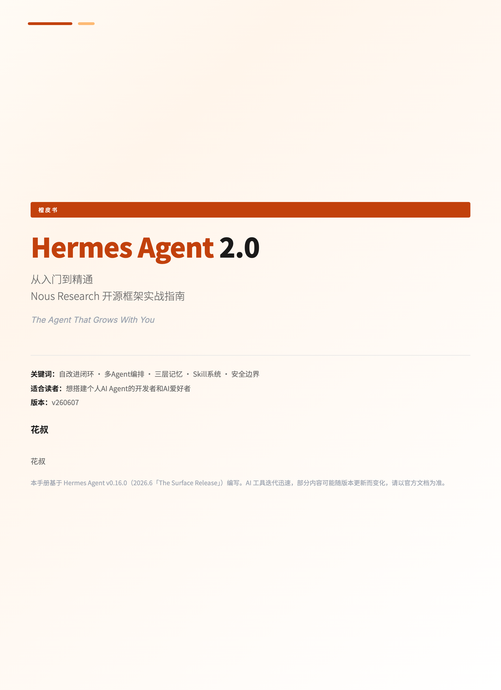
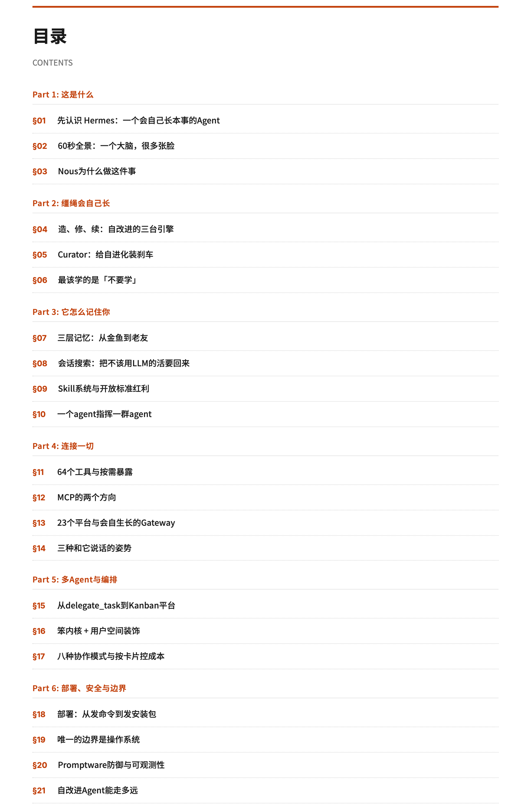
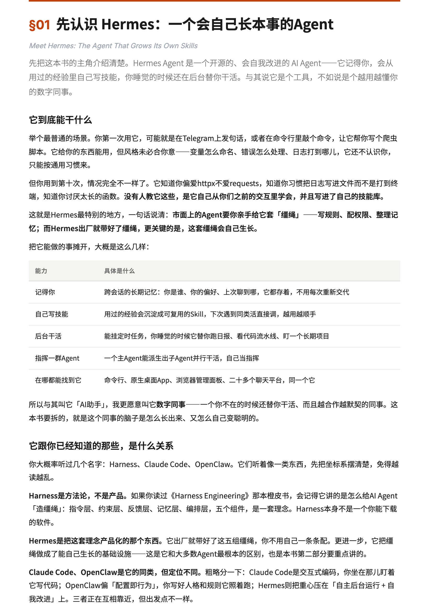
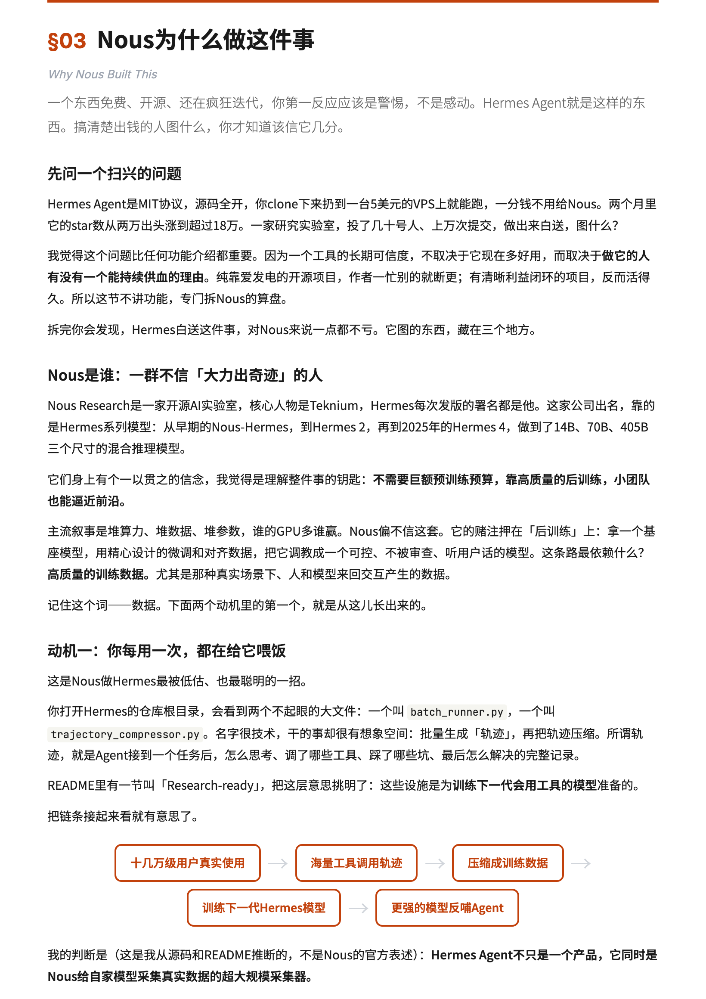

[English](README.md) | **中文**

  
   
  用 <a href="https://github.com/alchaincyf/huashu-design">huashu-design</a> skill 制作

# Hermes Agent橙皮书2.0

> 橙皮书系列 · 花叔 著

[Hermes Agent](https://github.com/NousResearch/hermes-agent) 是 [Nous Research](https://hermes-agent.nousresearch.com/) 开源的 AI Agent 框架——第一个出厂就带缰绳、而且缰绳会自己长大的 Agent。

**中文版已更新到第三版（v261020）**，基于 Hermes Agent v0.22.2（「The Threshold Release」）：在 6 月第二版的骨架上新增 Part 2 上手篇五节（安装、第一次对话、教它技能、定时任务与看板、浏览器面板），配 40 张隔离环境真机实测截图，并逐章把过时的数字和默认值改到 v0.22.2。

第二版是推倒重写：第一版基于 Hermes v0.7.0，两个月、九个版本之后它长出了原生桌面 App 和浏览器管理面板，所以围绕 v0.16.0（「The Surface Release」）重新拆了一遍。英文版目前仍是第二版。

  
  

## 下载

| 版本 | PDF |
|------|-----|
| 中文版（第三版 v261020） | **[PDF 下载](https://github.com/alchaincyf/hermes-agent-orange-book/raw/main/Hermes-Agent橙皮书2.0-v261020.pdf)** |
| English（第二版 v260607） | **[PDF Download](https://github.com/alchaincyf/hermes-agent-orange-book/raw/main/Hermes-Agent-The-Complete-Guide-v260607.pdf)** |

## 勘误

**§03「Nous为什么做这件事」里关于数据采集的推断，是错的。** 感谢 [@lishaogang](https://github.com/lishaogang) 在 [issue #7](https://github.com/alchaincyf/hermes-agent-orange-book/issues/7) 指出。

书里「动机一」写道：「Hermes Agent不只是一个产品，它同时是Nous给自家模型采集真实数据的超大规模采集器」，还画了一条「用户真实使用→工具调用轨迹→压缩成训练数据→训练下一代模型」的链条。这条链在第一环就断了：

- 官方 [FAQ](https://hermes-agent.nousresearch.com/docs/reference/faq) 写得很清楚：API 调用只发给你自己配置的模型提供商，Hermes Agent 不收集遥测、使用数据或分析数据，你的对话、记忆、Skill 全部存在本地`~/.hermes/`。
- 官方 [AGENTS.md](https://github.com/NousResearch/hermes-agent/blob/main/AGENTS.md) 更进一步，把「没有用户明确 opt-in 的出站遥测/使用归因」列为「做得再好也拒收」的贡献——想给 Hermes 加数据上报的代码，官方自己都不让进。

也就是说，你的使用轨迹留在你自己的电脑上，没有任何通道回流给 Nous。书里提到的 batch_runner.py、trajectory_compressor.py 和「Research-ready」都真实存在，但那是 Nous 和研究者在自己环境里批量生成训练轨迹用的研究设施，不是从用户那里收数据的管道。我当时把「它有生产轨迹的设施」推成了「它在收你的轨迹」，这一步推过头了。虽然原文标注了「这是推断，不是官方表述」，但一个被官方文档直接否定的推断，标注了也还是错的。

连带地，§03 结尾「数据飞轮」那部分论证也不成立——Nous 做 Hermes 的动机里，「Portal 商业化」和「抢 OpenClaw 的存量用户」两条依然成立，「用户给它喂训练数据」这条应当删去。

中文版 v261020 已按官方文档改正 §03 正文（「动机一」改为「它也是 Nous 自己的研究设施」），勘误也写进了给微信读书读者的话；英文版 v260607 还没改，以这里的勘误为准。判断产品事实，请以[官方文档](https://hermes-agent.nousresearch.com/docs/)为准。

## 这本书讲什么

[Hermes Agent](https://github.com/NousResearch/hermes-agent) 是 Nous Research 开源的 AI Agent 框架。它和 OpenClaw、Claude Code 走的路线不同：内建了自改进学习循环、三层记忆系统、Skill 自动创建和进化机制，这一版还多了持久化的多 Agent 看板平台 Kanban，和一套诚实的、以操作系统为边界的安全模型。

如果你读过《Harness Engineering》橙皮书，Hermes 是那本书讲的五个组件（指令/约束/反馈/记忆/编排）的产品化实现。

**中文版第三版共 26 节，分 7 个部分：**

| Part | 内容 | 章节 |
|------|------|------|
| 1. 这是什么 | 先认识 Hermes、一个大脑多张脸、Nous 为什么做 | §01-03 |
| 2. 跟着做（第三版新增） | 安装与向导、第一次对话与记忆、教它技能与 Curator、定时任务与看板、浏览器面板 | §04-08 |
| 3. 缰绳会自己长 | 自改进三引擎、Curator、最该学的是「不要学」 | §09-11 |
| 4. 它怎么记住你 | 三层记忆、会话搜索、Skill、指挥一群 Agent | §12-15 |
| 5. 连接一切 | 工具、MCP、二十多个平台、三种接入面 | §16-19 |
| 6. 多 Agent 与编排 | 从 delegate_task 到 Kanban 平台、八种协作模式 | §20-22 |
| 7. 部署、安全与边界 | 部署、唯一边界是操作系统、Promptware 防御、能走多远 | §23-26 |

  
  

## 适合谁读

- 用过 Claude Code / OpenClaw / Cursor，想了解 Hermes 的开发者
- 不写代码但重度用 AI 的人——Hermes 现在有了桌面 App，这本书也照顾你
- 对 Harness Engineering 概念感兴趣，想看它产品化、还会自我进化的人

## 橙皮书系列

本书是橙皮书系列之一。系列其他书目包括：Claude Code 从入门到精通、Harness Engineering、OpenClaw 等。

所有橙皮书免费下载：**[huasheng.ai/orange-books](https://www.huasheng.ai/orange-books)**

## 关于作者

**花叔** · AI Native Coder · 独立开发者

我一行代码都不会写，却用 AI 做出了 AppStore 付费榜 Top 1 的小猫补光灯，写了 9 本技术书。所有产品全部 AI 写的，我只负责想清楚要做什么。开源了女娲.skill、huashu-design 等项目。

- 公众号：花叔
- B站：[花叔v](https://space.bilibili.com/14097567/)
- X/Twitter：[@AlchainHust](https://x.com/AlchainHust)
- YouTube：[@Alchain](https://www.youtube.com/@Alchain)
- 小红书：[花叔](https://www.xiaohongshu.com/user/profile/5abc6f17e8ac2b109179dfdf)
- 官网：[huasheng.ai](https://www.huasheng.ai/)

## 版本

- **v261020** — 第三版（中文），基于 Hermes Agent v0.22.2（「The Threshold Release」）：新增上手篇五节、40 张实测截图，逐章更新，改正 §03 勘误
- **v260607** — 第二版（2.0），基于 Hermes Agent v0.16.0（「The Surface Release」）推倒重写
- **v260408** — 初版，基于 Hermes Agent v0.7.0
- AI 工具迭代迅速，部分内容可能随版本更新变化，请以官方文档为准

## 2.0 的变化

- **推倒重写，不是打补丁。** 从初版的 17 章 / 5 部分，重构为 21 节 / 6 部分，围绕 Hermes v0.16.0 重新解构。新增了自改进闭环（Curator）、多 Agent 看板平台 Kanban、安全模型这些初版几乎没碰的内容。
- **许可证改为 MIT。** 初版用的是 CC BY-NC-SA 4.0。从 2.0 起，本书改用 [MIT 许可证](LICENSE)——你可以自由使用、改编、再分发，包括商用。怎么用得上就怎么用。

## 关注花叔

## 📚 在线阅读（WorkBuddy）

本书已同步到 WorkBuddy 资料库：每章一个网页，也可以直接把链接丢给你的 Agent 当上下文。

https://www.workbuddy.cn/space/d/qAVr77wMMaD1AmkPtmL501

全部橙皮书入口：https://www.workbuddy.cn/space/d/YcllWXknAUoMk6lFSWdfbI
## 许可

[MIT 许可证](LICENSE)——可自由使用、复制、修改和分发，包括商用。注明出处更好，但不强制。
